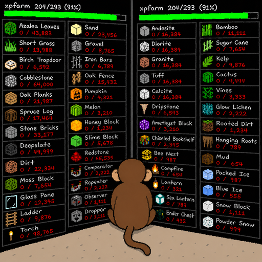
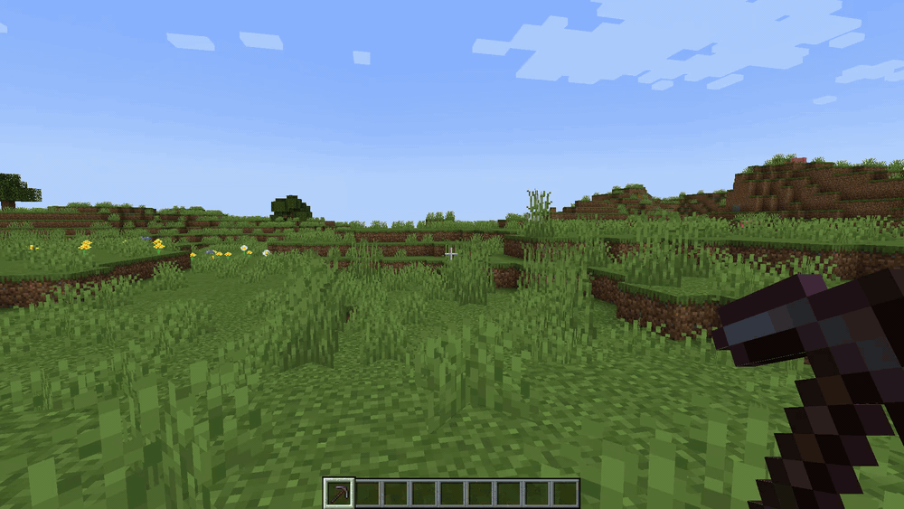
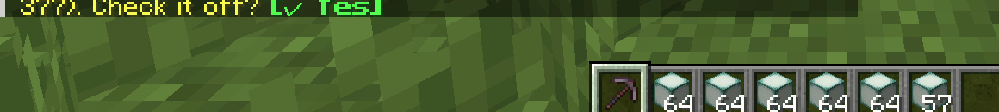
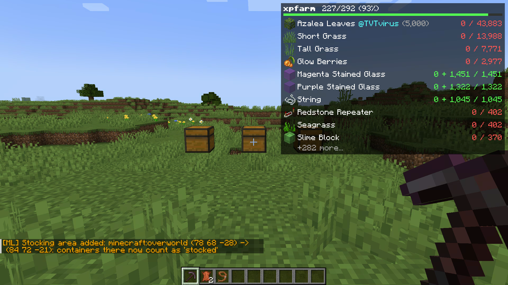
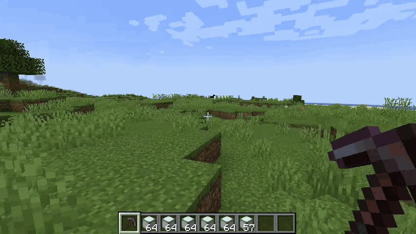
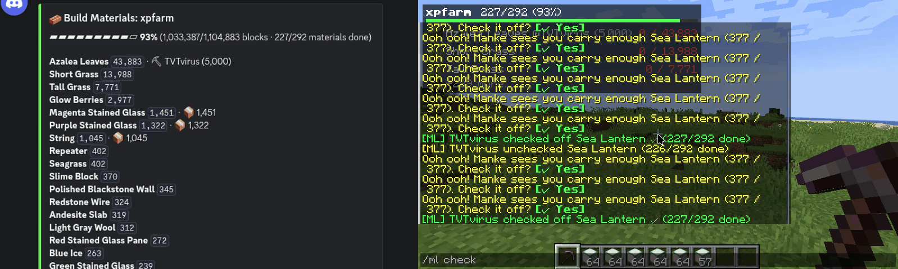

<div align="center">

# MankeList



**Lista de materiales compartida para proyectos comunitarios: HUD en vivo, checks por chat, claims, control de stock y un board de Discord que se actualiza solo. Un solo jar.**

[](https://www.minecraft.net/)
[](https://fabricmc.net/)
[](https://modrinth.com/mod/fabric-api)
[](#instalación)
[](LICENSE)

[English](README.md) | Español

</div>

Una lista de materiales compartida para proyectos grandes de la comunidad, para que todos vean
qué falta, quién está farmeando qué y cuánto llevan.

<div align="center">

</div>

- Importa la lista directo de un `.litematic` en el server con `/ml import`.
- Cualquiera marca un material terminado, y el server lo anuncia.
- Claims: `/ml claim obsidian` avisa a todos que estás con eso.
- Stocking areas: marcás el cuarto de cofres y lo guardado cuenta como progreso (shulkers incluidos).
- El aviso de Manke (si te apuntás con `/ml follow`): un mensaje privado clickeable cuando tu
  inventario cubre un material pendiente. Funciona sin el mod.
- Un board de Discord que el mod va editando, con un webhook. Sin bot.
- HUD opcional en el cliente, con conteo en vivo contra tu inventario.

## Instalación

- Minecraft 1.21 / 1.21.1 o 26.3, con [Fabric API](https://modrinth.com/mod/fabric-api).
  Java 21 para 1.21; Java 25 y Fabric Loader 0.19.5+ para 26.3.
- **Server (obligatorio):** poné el jar en `mods/` del server. Todo funciona con clientes vanilla.
- **Cliente (opcional):** el mismo jar agrega el HUD. A los clientes vanilla no les llega nada.

Al actualizar, conservá `config/mankelist/` y los archivos `mankelist-*.json`; se mantienen las
listas, los checks, los claims, los seguidores y las zonas de almacenamiento.

## Uso

```
/ml import mi_proyecto.litematic           arma y activa la lista desde la schematic
/ml follow                                 te apuntás a los avisos de Manke
/ml stockarea add 100 60 100 120 70 120    el cuarto de cofres de entrega
/ml check <material>                       marca un material como hecho
```



En el cliente, `J` muestra u oculta el HUD y `Shift+J` abre sus ajustes.

## Detalles

### Comandos

Para todos: `/ml status`, `/ml check`, `/ml uncheck`, `/ml claim`,
`/ml have <cantidad> <material>` (progreso parcial: "llevo 5.000 azaleas", te
claimea el material y suma a las barras), `/ml unclaim`, `/ml follow`,
`/ml unfollow`, `/ml stock` (reporte compacto de lo ya guardado), `/ml lists`.

Para OPs (nivel 2): `/ml import`, `/ml load` (relee el archivo, **resetea
checks**), `/ml switch` (reactiva una lista guardada **conservando el
progreso**), `/ml unload`, `/ml reset [lista]`, `/ml stockarea add/list/clear`.

Puede haber varias listas activas a la vez; si un material está en más de
una, se desambigua como `lista/material` (ej. `/ml check xpfarm/hopper`); el
autocompletado y los botones de Manke lo hacen solos. La tabla completa está
en el [README en inglés](README.md#commands).

### El HUD (mod cliente)



<div align="center">


</div>

`J` muestra/oculta, `Shift+J` abre los ajustes in-game (también desde
Mod Menu o una tecla asignable) y `K` cicla la lista enfocada. Todas las teclas se pueden reasignar en
**Opciones → Controles**, categoría *MankeList*, por si `J`/`K` chocan con
otro mod. Las filas pendientes muestran **llevas +
guardado / necesita** con colores rojo/amarillo/verde; las hechas se
contraen a un ✓ y los claims salen como `@Nombre`. Orden por cantidad o
totalmente personalizado (agarrar y soltar, con buscador).

### Board de Discord

1. En tu canal: **Editar canal → Integraciones → Webhooks → Nuevo webhook**,
   copia la URL.
2. Pégala en `config/mankelist-server.json` → `"discordWebhookUrl"`.
3. Reinicia. El mod postea el board y desde ahí **lo edita en el sitio** cada
   vez que la lista cambia (máximo una vez cada 10 s).

La referencia completa de la config del server está en el
[README en inglés](README.md#server-config).

## Licencia

[MIT](LICENSE). El layout del HUD está inspirado en la material list de
Litematica; escrito de cero, sin código copiado.
